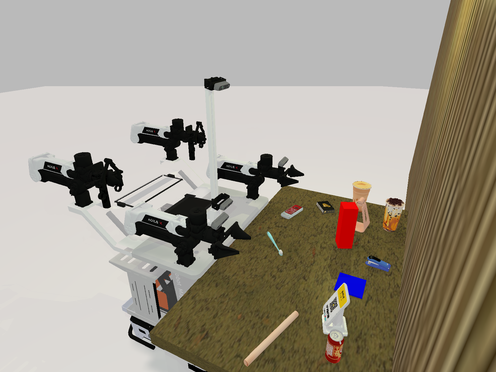

# RoboTwin — macOS Port

A macOS port of [RoboTwin 2.0](https://github.com/RoboTwin-Platform/RoboTwin) for Apple Silicon, preserving the upstream task, observation, and action interfaces.



## Installation

Requires Apple Silicon, Homebrew at `/opt/homebrew`, and Xcode Command Line Tools. Allow approximately 40 GB for the Python environment, downloaded archives, and extracted assets.

```sh
gh repo clone mhlee1215/robotwin-macos
cd robotwin-macos

# Install Command Line Tools if they are not already installed.
xcode-select --install
brew install uv molten-vk vulkan-loader

uv venv --python 3.11 .venv
.venv/bin/python bootstrap_macos.py
```

The installer checks out RoboTwin at commit `ea8b21121ebb3cd201ff5b3fe361944ac94eda3f`, applies the macOS patch, installs pinned dependencies, and downloads the official assets with SHA-256 verification. The RoboTwin checkout is in `vendor/RoboTwin/`.

## RoboTwin interface

Use the existing RoboTwin task classes and configuration files:

| Component | Upstream location in the checkout |
|---|---|
| Task classes | `envs/<task_name>.py` |
| Task configurations | `env_cfg/task_config/demo_clean.yml`, `demo_randomized.yml` |
| Embodiment configuration | `env_cfg/task_config/_embodiment_config.yml` |
| Robot assets | `assets/embodiments/` |

The task interface retains the upstream method names and arguments:

| Method | Purpose |
|---|---|
| `task.setup_demo(**args)` | Initialize an episode using resolved task and embodiment settings |
| `task.get_obs()` | Read the RoboTwin observation dictionary |
| `task.take_action(action, action_type="qpos")` | Apply joint-position and gripper commands |
| `task.take_action(action, action_type="ee")` | Apply end-effector pose and gripper commands |
| `task.play_once()` | Run the task's scripted expert |
| `task.check_success()` | Evaluate the task's existing success condition |
| `task.close_env()` | Close the environment |

Observation keys, action layouts, task names, and YAML configuration keys follow the pinned RoboTwin source. Resolve `args` from the task and embodiment configuration as in upstream RoboTwin. For example, the control loop after initialization uses the same calls:

```python
observation = task.get_obs()
action = policy(observation)
task.take_action(action, action_type="qpos")
success = task.check_success()
```

Run your Python integration through the macOS launcher:

```sh
sh mac_python.sh /absolute/path/to/your_script.py
```

The launcher selects the Python environment, configures the macOS graphics libraries, and runs from the RoboTwin checkout so upstream relative paths resolve correctly. It forwards Python arguments unchanged. General task and configuration usage is described in the [RoboTwin documentation](https://robotwin-platform.github.io/doc/).

## macOS verification

```sh
.venv/bin/python run_task.py --mode simulator --reset-check --pointcloud --overview --output artifacts/my_simulator_check
```

This optional port diagnostic writes images and `result.json`; it is separate from RoboTwin's task API. Verified on Apple M5 Pro with macOS 26.6.2, Python 3.11.15, SAPIEN 3.0.3, and the default ALOHA-agilex embodiment. All 50 task environments were exercised using the explicitly recorded valid seeds: 49 passed at seed 0, and `pick_diverse_bottles` passed separately at seed 1 after seed 0 failed the initial stability check.

The macOS backend uses CPU PhysX, Metal rendering and planning kernels, and MPS pointcloud processing. Interface compatibility does not imply identical planning behavior or task success rates to CUDA cuRobo. Verification scope, expert-planning limitations, and reproduction commands are documented in [Simulator verification](SIMULATOR_VERIFICATION.md) and [Metal backend](METAL_BACKEND.md).

## Attribution

Based on [RoboTwin](https://github.com/RoboTwin-Platform/RoboTwin). This is an independent macOS port. See [LICENSE](LICENSE) and [third-party notices](THIRD_PARTY_NOTICES.md) for attribution and licensing.
